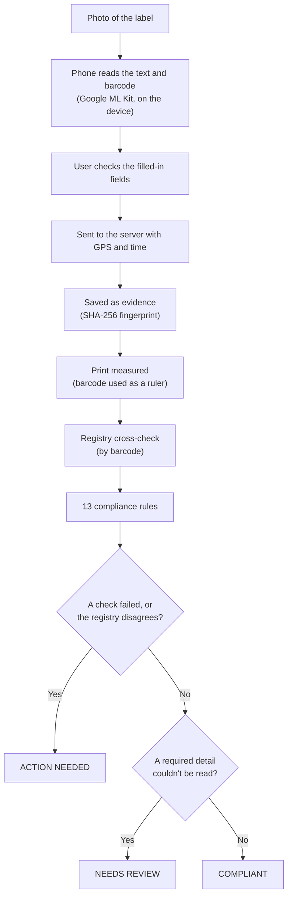
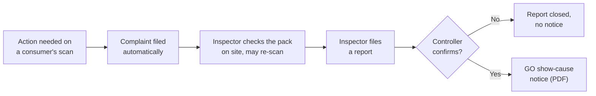

# FieldProof — Legal Metrology Compliance Scanner

**Smart India Hackathon 2026 · Problem statement SIH26231 · Team HexTech**

Photograph the label of a packaged product. FieldProof reads it, checks it against the
**Legal Metrology (Packaged Commodities) Rules, 2011**, compares it with the
registered product, saves the photo as tamper-evident evidence, and carries a
real violation from a consumer's scan to the Controller's show-cause notice.

> **Status:** working prototype (TRL 4), tested end to end by our team on real
> packs. It is not a production deployment.

| Part | Folder | Built with | Used by |
| --- | --- | --- | --- |
| Mobile app | [`mobile/`](mobile/) | Flutter (Android), Google ML Kit | Consumers, inspectors |
| Server | [`Backend/`](Backend/) | FastAPI, PostgreSQL, OpenCV | Everyone, through the app and dashboard |
| Dashboard | [`Frontend/`](Frontend/) | React, Vite, Leaflet | The Field Drug Testing Dashboard |

---

## Why

Every packaged product sold in India must declare its maker, net quantity,
MRP, dates and customer care details. Today inspectors check labels by hand,
one pack at a time. And checking "is the MRP printed?" is not enough: a
sticker that raises the MRP still leaves a complete-looking label.

FieldProof checks whether the declarations are **there**, whether they are **true**
(against the registered product), and keeps evidence that can stand up later.
When it cannot tell, it says so and lets a person decide.

---

## How it works



When action is needed, the case goes through people, never straight to a
penalty:



---

## Features

### Mobile app (consumers and inspectors)

- **Scan** from the camera or the gallery. ML Kit reads the text and barcode on
  the phone, and the app fills in the fields: maker and address, product name,
  net quantity, MRP and unit sale price, dates, batch, customer care, FSSAI
  licence and GSTIN.
- **Review Details**: fix anything misread; every change is recorded with the
  scan. **Scan another part** adds up to 3 photos of other faces, such as the
  seal, the lid or the veg mark, when the label says a detail is printed
  elsewhere.
- **Result**: Compliant, Needs review or Action needed, with all 13 checks and
  their reasons, the registry result, who read the barcode, the veg mark, and
  the complaint number if one was filed.
- **Consumers** see only their own scans.
- **Inspectors** get the pending complaints (as a list and on a map), the full
  scan history, their own new scans, and a report form. A registry mismatch
  can be cited only after they tick that they checked the pack themselves.
- The backend address can be changed in **Settings**, so no rebuild is needed
  to move between networks.
- Admin accounts are sent to the dashboard; the app is not for them.

### Controller dashboard (web)

- **Queue** of inspectors' reports.
- **Report page**: the evidence photo and any extra photos, a live SHA-256
  check proving each photo is unchanged since capture, GPS and time, the
  grounds cited and the inspector's notes. **Confirm** or **reject**, then
  **issue the GO show-cause notice** as a PDF.
- **System Log**: every scan, searchable by product, barcode, scan number,
  complaint number or user; a compliance report PDF per scan; CSV export.
- **Map** of complaints and reports.
- **Rules**: the 13 rules with their legal provisions. A rule switched off
  here is recorded as `EXEMPT` on new scans.

---

## What gets checked

### The 13 compliance rules

The rules are stored as data in the `rules` table, so the dashboard can list
them and switch them on or off.

| # | Check | Provision | Severity |
| --- | --- | --- | --- |
| 1 | Manufacturer / packer / importer name and address | Rule 6(1)(a) | major |
| 2 | Country of origin (imported packs) | Rule 6(1)(aa) | moderate |
| 3 | Common or generic name | Rule 6(1)(b) | major |
| 4 | Net quantity | Rule 6(1)(c) | critical |
| 5 | Retail sale price (MRP), with the unit sale price | Rule 6(1)(e) | critical |
| 6 | Month and year of manufacture / packing | Rule 6(1)(d) | major |
| 7 | Best before / use by date | Rule 6(1)(da) | major |
| 8 | Consumer care details | Rule 6(2) | moderate |
| 9 | Minimum letter height | Rule 7(2) and Table I | moderate |
| 10 | Legibility and contrast | Rule 9(1) | moderate |
| 11 | Placement on the principal display panel | Rule 8(1) | minor |
| 12 | LMPC registration number | Rule 27 | major |
| 13 | GSTIN format and checksum | CGST Rules, 2017, Rule 46 | minor |

"Rule 9" in the app means our check number 9; the **Provision** column is the
statute. Provisions are from the LMPC Rules, 2011 as amended up to 2017.

### Beyond the rules

- **Registry cross-check.** The barcode looks up the registered product, and
  the label's MRP, net quantity, FSSAI licence, GSTIN, veg mark and maker are
  compared with it. A contradiction is flagged as suspected tampering.
  - An MRP **higher** than registered is tampering. A **lower** MRP is not:
    Rule 6(3) allows a sticker that lowers the MRP, so it is recorded as a
    difference.
  - Product name and address are free text that OCR often misreads, so
    differences there are recorded but not treated as tampering. So is an
    FSSAI licence that isn't 14 digits, or is one digit off a registered one.
- **FSSAI veg / non-veg mark.** Found by its shape (a dot inside a square
  outline of the same colour, on a light label) and checked against the
  registry. If the whole shape isn't visible it says "not detected" instead of
  guessing.
- **Print measurement.** An EAN-13 barcode is printed to a standard width
  (37.29 mm), so its width in pixels gives millimetres per pixel. That turns
  letter heights into millimetres (check 9) and measures contrast (check 10).
- **Evidence.** Each photo gets a SHA-256 fingerprint, GPS with its accuracy,
  and the phone's time checked against internet (NTP) time. A submitted scan
  is never edited: a rescan is a new record linked to the first, the same
  photo sent twice is flagged, and fields the user changed are recorded.

---

## Results, and why REVIEW matters

Every check returns `PASS`, `FAIL`, `REVIEW` or `EXEMPT`.
**`REVIEW` is not a violation.** It means the system could not establish the
answer from the photo, so a person should look. This is deliberate:

- A heading that was read with no value beside it (a finger over the MRP, say)
  is `REVIEW`, not `FAIL`. A `FAIL` for a missing declaration needs the
  heading to be missing too.
- Check 9 never fails a pack from a photo. A barcode may be printed at 80–200%
  of its standard size, so a reading under the limit asks for a measurement on
  the pack.
- Check 10 passes at 4.5:1, fails only below 1.5:1, and is `REVIEW` in
  between, because phone photos understate print contrast.
- Check 11 measures whether the declarations are grouped together. It is a
  labelled proxy (`dispersion_proxy`), not true display-panel detection.
- Check 13 validates the GSTIN's format and checksum only. It never claims a
  live GST registration lookup.

Each scan gets one of three verdicts:

| Verdict | When | What happens |
| --- | --- | --- |
| **Compliant** | Every required detail was read and nothing failed | Nothing more |
| **Needs review** | Nothing failed, but a required detail couldn't be read | The user is told what to check; no complaint |
| **Action needed** | A check failed, or the label contradicts the registry | A consumer's scan files a complaint for an inspector |

**What a report can cite.** An inspector's report cites only `FAIL`ed checks,
plus one other ground: a registry mismatch in MRP, net quantity or maker, cited
under **Rule 6(3)** (no altering a declaration on the pack). That ground is
accepted only after the inspector confirms they checked the physical pack,
because a misread photo can look exactly like tampering.

**Who can do what** is enforced by the server, not just the UI. Inspectors
file reports; only the Controller confirms them and issues notices. An
inspector trying to issue a notice gets `403`, a notice before confirmation
gets `409`, and each report gets at most one notice, even when two clicks
arrive at the same moment.

---

## Tech stack

| Area | Tools |
| --- | --- |
| Mobile | Flutter, Provider, Dio, Google ML Kit (text recognition, barcode scanning), camera, image_picker, geolocator, ntp, flutter_map |
| Server | Python 3.11, FastAPI, SQLAlchemy 2, Alembic, PostgreSQL, OpenCV, pyzbar, ReportLab, python-jose (JWT), passlib/bcrypt |
| Dashboard | React 18, Vite 5, React Router, Leaflet / react-leaflet |
| Maps | OpenStreetMap tiles |

---

## Repository layout

```
Backend/
  app/
    core/            login tokens and role checks
    models/          database tables (users, evidence, rules, reports, notices, registry…)
    routers/         API: auth, scan, inspections, complaints, violations, rules, legal-notice
    schemas/         request and response shapes
    services/
      compliance_rules.py       the 13 checks
      compliance_aggregator.py  turns the checks into one verdict
      authenticity_service.py   registry cross-check
      fssai_mark_service.py     veg / non-veg mark detector
      cv_service.py             barcode-as-ruler measurement, contrast
      barcode_service.py        server-side barcode reading (pyzbar)
      violation_service.py      report → confirm → notice workflow
      report_service.py         the compliance report PDF and the GO notice PDF
    scripts/         seed_rules, seed_product_registry, create_user
    utils/           GSTIN validator, logging
  alembic/versions/  database migrations 0001–0008
  tests/             pytest suite and image fixtures

Frontend/src/
  pages/             Login, Queue, ReportDetail, SystemLog, MapView, Rules

mobile/
  lib/
    models/  providers/  services/  utils/  widgets/
    screens/consumer/   scan → review details → result, my scans
    screens/inspector/  complaints, map, scan log, scan detail, file report
  android/           Android project (manifest, Gradle, icons)
  test/              flutter tests and real OCR fixtures

docker-compose.yml   PostgreSQL and the API in containers (optional)
```

---

## Getting started

### Prerequisites

| Tool | Version | For |
| --- | --- | --- |
| Python | 3.11 | Server |
| PostgreSQL | 15 or newer | Database |
| Node.js | 18 or newer | Dashboard |
| Flutter | 3.x stable (we use 3.47) | Mobile app |
| JDK | 17 or 21 | Android builds (JDK 24/25 are not supported by the Android Gradle plugin) |
| Android SDK + NDK | NDK `28.2.13676358` | ML Kit's native parts need the NDK |

An Android phone with Google Play services is needed for ML Kit.

### 1. Database

Run these as three separate commands (`CREATE DATABASE` can't run inside a
transaction block):

```bash
psql -U postgres -c "CREATE USER fieldproof WITH PASSWORD 'fieldproof_dev';"
psql -U postgres -c "CREATE DATABASE fieldproof_db OWNER fieldproof;"
psql -U postgres -c "GRANT ALL PRIVILEGES ON DATABASE fieldproof_db TO fieldproof;"
```

Add `-p <port>` if your PostgreSQL isn't on 5432.

### 2. Server

```bash
cd Backend
python -m venv venv
venv\Scripts\activate            # Windows
# source venv/bin/activate       # macOS / Linux
pip install -r requirements.txt
```

Create `Backend/.env` from the template and set a real secret key:

```bash
cp .env.example .env
python -c "import secrets; print(secrets.token_hex(32))"   # paste as SECRET_KEY
```

If your database isn't on `localhost:5432`, change `DATABASE_URL` in `.env`.
On macOS/Linux, pyzbar also needs the zbar library
(`sudo apt install libzbar0` or `brew install zbar`); on Windows it comes with
the package.

Create the tables, load the 13 rules and the product registry, and start:

```bash
alembic upgrade head
python -m app.scripts.seed_rules
python -m app.scripts.seed_product_registry
python -m uvicorn app.main:app --host 0.0.0.0 --port 8000
```

Check it with `http://localhost:8000/health`. Interactive API docs are at
`http://localhost:8000/docs`.

### 3. Accounts

Public sign-up only creates **consumer** accounts. Inspector and admin
accounts carry enforcement powers, so they are made from the command line (or
by an admin through `POST /auth/users`):

```bash
python -m app.scripts.create_user --username test_admin --email admin@example.com \
    --full-name "Test Controller" --role admin --password "<password>"
python -m app.scripts.create_user --username test_inspector --email inspector@example.com \
    --full-name "Test Inspector" --role inspector --badge-number INSP-01 --password "<password>"
python -m app.scripts.create_user --username test_consumer --email consumer@example.com \
    --full-name "Test Consumer" --role consumer --password "<password>"
```

The app's login screen has quick sign-in buttons for `test_inspector` and
`test_consumer` using the password `Password123!`. Give those two accounts
that password if you want the buttons to work. Use them only on a local demo
server, never on a public one.

Admins sign in on the **dashboard**; the app shows them a redirect screen.

### 4. Dashboard

```bash
cd Frontend
npm install
npm run dev
```

Open `http://localhost:5173`. It must be served like this; opening
`index.html` as a file shows a blank page. The API address defaults to
`http://localhost:8000`; set `VITE_API_BASE` to change it.

### 5. Mobile app

Build with the backend address baked in, then install over USB:

```bash
cd mobile
flutter pub get
flutter build apk --debug --dart-define="LABELGUARD_API_BASE=http://localhost:8000"
adb install -r build/app/outputs/flutter-apk/app-debug.apk
adb reverse tcp:8000 tcp:8000
```

`adb reverse` tunnels the phone's `localhost:8000` to the laptop over the USB
cable. It is the most reliable setup, and it has to be run again after the
phone is unplugged or sleeps.

Over Wi-Fi instead: put the laptop's IP address (`ipconfig` / `ip addr`) in
the app's **Settings**, for example `http://192.168.1.20:8000`, and allow
port 8000 through the laptop's firewall. The Android emulator reaches the
laptop at `http://10.0.2.2:8000`, which is the app's default when nothing is
set.

**Windows note:** `mobile/android/gradle.properties` sets
`-Djdk.net.unixdomain.tmpdir=C:\jtmp`. It is needed when the Windows user name
contains a space: without it, Gradle fails with "Unable to establish loopback
connection". Create the folder once with `mkdir C:\jtmp`. On macOS or Linux,
remove that flag from `org.gradle.jvmargs`.

---

## Tests

```bash
cd Backend && python -m pytest tests/ -q     # 333 tests
cd mobile  && flutter test                   # 97 tests
```

Server tests run on in-memory SQLite. One test, two "Issue notice" clicks
racing each other, needs PostgreSQL and is skipped without it.

---

## API overview

The full, live reference is at `/docs` when the server runs.

| Method | Path | Who |
| --- | --- | --- |
| POST | `/auth/register` (consumers only), `/auth/login` | anyone |
| GET | `/auth/me` | signed in |
| POST | `/auth/users` (any role) | admin |
| POST | `/scan` (photo, extra photos, fields read on the phone) | signed in |
| GET | `/scan/history` (own scans) | signed in |
| GET | `/inspections/log` (every scan) | inspector, admin |
| GET | `/inspections/{id}`, `/inspections/{id}/image`, `/inspections/{id}/extra-image/{n}` | inspector, admin; a consumer only for their own scan |
| GET | `/complaints/pending` | inspector, admin |
| GET | `/legal-notice/{id}/generate` (compliance report PDF) | admin |
| POST | `/violations` (file a report) | inspector, admin |
| GET | `/violations`, `/violations/{id}` | inspector (own), admin (all) |
| POST | `/violations/{id}/confirm`, `/violations/{id}/reject` | admin |
| POST | `/violations/{id}/notice` | admin |
| GET | `/violations/{id}/notice.pdf` | inspector, admin |
| GET | `/rules` | signed in |
| PATCH | `/rules/{id}` (switch a rule on or off) | admin |

---

## Known limitations

1. **OCR sets the ceiling.** A blurred, far or glossy photo can hide details.
   Most of that turns into `REVIEW` or Needs review rather than a false
   `FAIL`, and every notice still needs an inspector and the Controller.
2. **The product registry is small**: 5 illustrative products and 3 real packs
   (Haldiram's Aloo Bhujia 400 g, Ob & Gob Tiramisu & Fudge Ice Cream 200 ml,
   Amul Dark Chocolate 35 g). In real use it would be GS1 India's DataKart,
   which brand owners already fill.
3. **Letter height assumes a flat, front-on photo** and a barcode printed at
   standard size. That is why check 9 never fails a pack on its own.
4. **Contrast from a photo is indicative only.** The 1.5:1 floor was set from
   real packs, not a calibration study.
5. **Placement (check 11) is a proxy**, not true principal-display-panel
   detection.
6. **The veg mark is often "not detected"** on glossy pouches. The detector
   declines rather than guesses; a close extra photo of the mark helps.
7. **GSTIN is checked for format and checksum only**, with no live GST lookup.
8. **English labels only** for now.

---

## Troubleshooting

| Problem | Fix |
| --- | --- |
| Dashboard shows a blank page | Open `http://localhost:5173` (from `npm run dev`), not the file |
| App says it can't reach the server | Re-run `adb reverse tcp:8000 tcp:8000`, or check the address in the app's Settings |
| A scan is rejected with 401 | The login expired; sign in again |
| Gradle: "Unable to establish loopback connection" | Create `C:\jtmp` (see the Windows note above) |
| Gradle fails on JDK 24 or 25 | Use JDK 17 or 21 |
| Checks 9–11 are always `REVIEW` | No barcode was found in the photo, so there was no scale; photograph the barcode flat and in focus |

---

## Team

**Team HexTech**, Smart India Hackathon 2026, problem statement **SIH26231**:
compliance checking of packaged commodities under the Legal Metrology
(Packaged Commodities) Rules, 2011.
